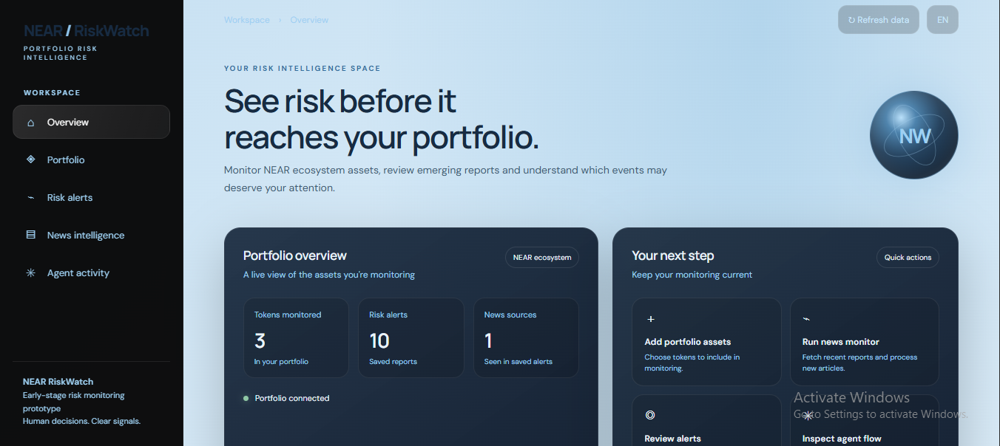
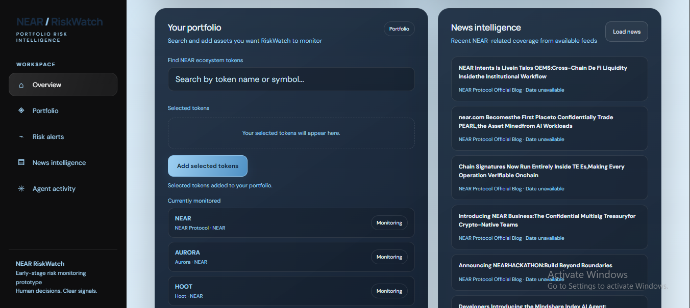
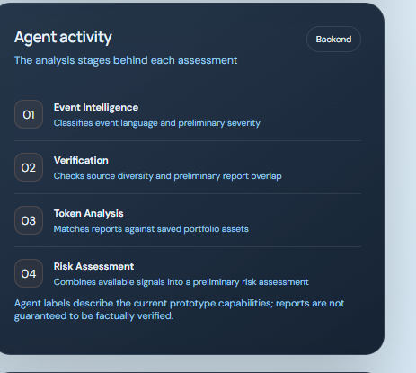
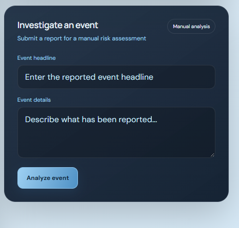

# NEAR RiskWatch

### Proactive Portfolio Risk Monitoring for the NEAR Ecosystem



NEAR RiskWatch is a portfolio risk monitoring prototype designed to help traders identify potential risks affecting the tokens they hold.

It monitors relevant crypto news, screens reported events, checks for preliminary corroboration, analyzes possible portfolio relevance, and presents risk alerts to help traders make more informed decisions.

## The Problem

Crypto markets can react quickly to security incidents, geopolitical developments, economic changes, and ecosystem-specific events.

Traders may struggle to keep up with information from multiple sources and understand how emerging events could affect the assets they hold.

NEAR RiskWatch aims to make this process easier through automated news monitoring and structured risk analysis.

## How It Works

NEAR RiskWatch uses four cooperating analysis components:

1. **Event Intelligence Agent** — Screens incoming news for relevant risk keywords and assigns an initial severity level.
2. **Verification Agent** — Examines available reports, compares source domains, and checks text similarity for potential corroboration. This is a preliminary check, not factual verification.
3. **Token Analysis Agent** — Compares detected events with tokens and projects saved in the user's portfolio.
4. **Risk Assessment Agent** — Combines the analysis results to produce a preliminary risk level, affected-token information, an explanation, and a recommended action.

## Product Screenshots

### Portfolio and news intelligence



### Agent activity



### Manual event analysis



## Key Features

- Manual portfolio token management.
- News monitoring from the NEAR Protocol blog and selected crypto news RSS feeds.
- Event screening and severity classification.
- Preliminary multi-source corroboration checks.
- Portfolio relevance analysis.
- Risk alerts and recommended actions.
- Dashboard for viewing news and risk information.
- Duplicate article detection to avoid processing the same article repeatedly.

## Technology Stack

- **Backend:** Python, FastAPI
- **Frontend:** HTML, CSS, JavaScript
- **Database:** SQLite
- **News collection:** Requests, Feedparser, BeautifulSoup
- **API documentation:** FastAPI Swagger UI

## Project Structure

```text
practicing/
├── backend/
├── frontend/
│   └── index.html
├── main.py
├── riskwatch.db
├── README.md
└── screenshots/
    ├── dashboard-overview.png
    ├── portfolio-and-news.png
    ├── agent-activity.png
    └── manual-event-analysis.png
```

The local virtual environment (`.venv/`) is not included in the repository. Each developer should create their own environment.

## Getting Started

### Requirements

- Python 3.13 or a compatible Python 3 version
- Internet connection for retrieving news

### 1. Clone the repository

Replace the placeholder with your GitHub repository URL:

```bash
git clone YOUR_GITHUB_REPOSITORY_URL
cd practicing
```

### 2. Create a virtual environment

On Windows:

```powershell
py -m venv .venv
```

### 3. Activate the environment

```powershell
.\.venv\Scripts\Activate.ps1
```

### 4. Install dependencies

```powershell
pip install fastapi uvicorn requests feedparser beautifulsoup4 pydantic
```

### 5. Start the backend

```powershell
python -m uvicorn main:app --host 127.0.0.1 --port 8001
```

### 6. Start the frontend

Open a second terminal in the project folder:

```powershell
py -m http.server 5500 --directory frontend --bind 127.0.0.1
```

Open the dashboard at http://127.0.0.1:5500.

API documentation: http://127.0.0.1:8001/docs

## Important API Endpoints

| Method | Endpoint | Purpose |
|---|---|---|
| `GET` | `/monitor/news` | Retrieves available news articles |
| `POST` | `/monitor/run` | Runs the risk monitoring process |
| `GET` | `/alerts` | Retrieves stored risk alerts |
| `POST` | `/events/analyze` | Screens an event |
| `POST` | `/risk/analyze` | Runs risk analysis |

## Current Limitations

NEAR RiskWatch is an early-stage prototype.

- Verification uses source-domain comparison and basic text similarity. It does not establish factual truth.
- Risk classifications are preliminary and should not be treated as guaranteed predictions of market movements.
- Portfolio relevance does not establish actual financial exposure.
- Monitoring is initiated manually rather than continuously in the background.
- RiskWatch does not execute trades or automatically sell tokens.
- News availability and article formatting depend on external sources.

## Project Vision

The goal is to help traders move from reacting to market events after they happen to becoming more aware of potential risks as information emerges.

By connecting news intelligence, portfolio relevance, and structured risk assessment, NEAR RiskWatch aims to make emerging developments easier to understand and evaluate.

**Better information. Earlier awareness. More informed decisions.**

---

Built for the **NEAR Build Beyond Boundaries Hackathon — November 2026**.

*NEAR RiskWatch is an informational prototype, not a financial advisory service. Users remain responsible for their own trading decisions.*
